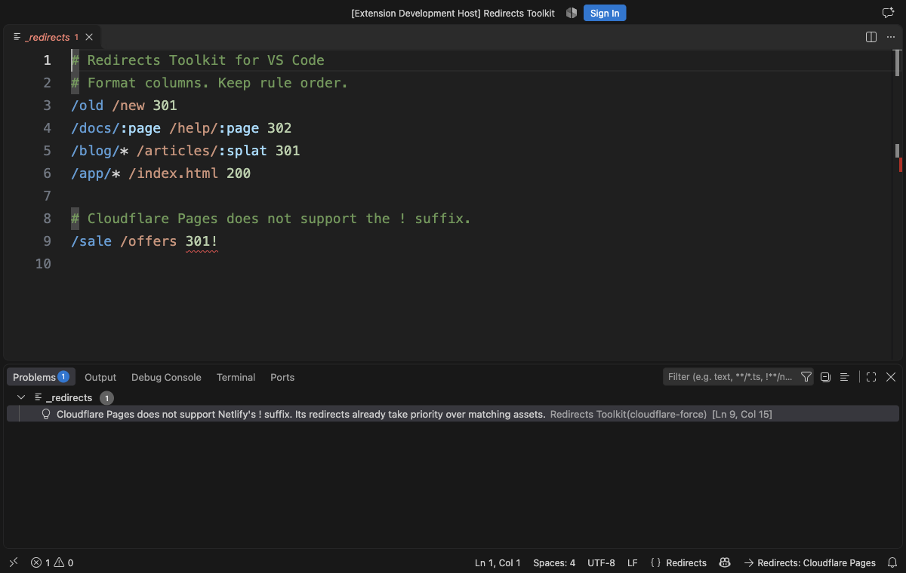
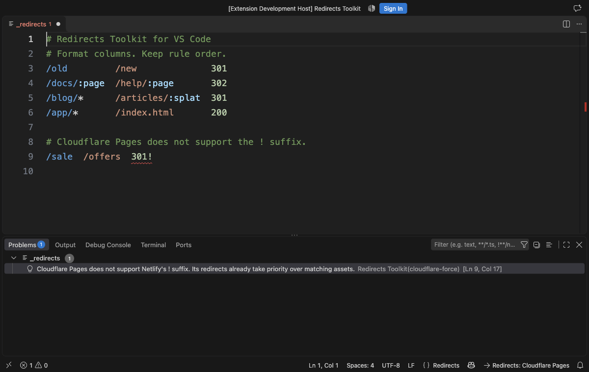

# Redirects Toolkit for VS Code

Highlight syntax, format columns, and check `_redirects` files for Netlify and Cloudflare Pages.

[Source code](https://github.com/sasivarnan/vscode-redirects-toolkit) · [Report a problem](https://github.com/sasivarnan/vscode-redirects-toolkit/issues) · [Contribute](CONTRIBUTING.md)

The extension runs on your computer. It does not collect usage data or send network requests.
You do not need an account to use it.

## Features

- Open an `_redirects` file to select the Redirects language automatically.
- See different colors for paths, status codes, placeholders, conditions, and comments.
- Align columns with **Format Document**.
- Enable automatic formatting when you save a file.
- See errors and warnings in the Problems panel.
- Put the pointer on a rule part to see help and links to the host documentation.
- Get suggestions for status codes and Netlify condition names.
- Type `:` in a destination to get suggestions for captured values.
- Select Netlify or Cloudflare Pages rules from the status bar.

The desktop editor tests passed on macOS. Web and remote editor tests remain open.

## Preview

These images show the extension in a VS Code test window.
The example includes a `301!` rule to show a Cloudflare Pages error.
The error stays visible after formatting.

### Before formatting



### After formatting



## Format an _redirects file

1. Open the `_redirects` file in VS Code.
2. Open the Command Palette.
3. Run **Format Document With...**.
4. Select **Redirects Toolkit for Netlify and Cloudflare**.

The formatter aligns the columns:

```text
# Before
/old /new 301
/blog/* /articles/:splat 302

# After
/old     /new              301
/blog/*  /articles/:splat  302
```

The formatter keeps the rule order, rule values, comments, blank lines, and line endings.
It does not add a missing status code.

Blank lines, comment lines, and incomplete rules separate groups of columns.
The formatter aligns each group separately.
The padding limit prevents large spaces after short values.

The formatter keeps incomplete or unclear rules unchanged.
It can format a clear rule that has a host error.
Formatting does not correct that error.

## Install the extension

If you have the VSIX package, use these steps:

1. Open VS Code.
2. Open the Command Palette.
3. Run **Extensions: Install from VSIX...**.
4. Select the generated `.vsix` file.

To build the package from the source files, use Node.js 24 and pnpm 12.18.0.
Get the source files and run these commands:

```sh
git clone https://github.com/sasivarnan/vscode-redirects-toolkit.git
cd vscode-redirects-toolkit
pnpm install --frozen-lockfile
pnpm check
pnpm package
```

The package uses publisher ID `sasivarnan`.
These commands build a local package.
See [the publishing steps](docs/publishing.md) to publish through GitHub Actions.

If another extension opens the file, run **Change Language Mode** and select **Redirects**.
Then use **Format Document With...** to select this extension.

## Select the host

Netlify and Cloudflare Pages have different redirect rules.
Select the correct host to enable its checks.

Run **Redirects: Select Host** or select the host name in the status bar.

The default setting is `auto`.
The extension looks for these configuration files at the top level of the current workspace folder:

| Configuration files                                        | Selected rules   |
| ---------------------------------------------------------- | ---------------- |
| `netlify.toml` only                                        | Netlify          |
| `wrangler.toml`, `wrangler.json`, or `wrangler.jsonc` only | Cloudflare Pages |
| Both types, or no matching files                           | Common syntax    |

A Wrangler file can also configure a Worker.
Automatic detection does not confirm that the project uses Cloudflare Pages.
Use **Redirects: Select Host** if the selection is incorrect.

The extension does not examine configuration files in subfolders or package scripts.
If a workspace has multiple folders, it checks each folder separately.
For a file outside a workspace, it uses common syntax checks unless you select a host.

The selection command saves the host in the current workspace folder settings.
For a file outside a workspace, it saves the host in user settings.

Host settings: `auto`, `cloudflare`, `netlify`, and `generic`.

## Enable formatting on save

Add these settings to your VS Code workspace settings:

```json
{
  "redirects.host": "cloudflare",
  "[redirects]": {
    "editor.defaultFormatter": "sasivarnan.redirects-toolkit",
    "editor.formatOnSave": true
  }
}
```

Use `netlify` instead of `cloudflare` for a Netlify project.
Use `auto` to enable automatic host selection.

## Settings

| Setting                        | Default | Function                                                 |
| ------------------------------ | ------- | -------------------------------------------------------- |
| `redirects.host`               | `auto`  | Select the host rules.                                   |
| `redirects.validation.enabled` | `true`  | Show errors and warnings.                                |
| `redirects.format.columnGap`   | `2`     | Set the minimum spaces between columns. Range: 1 to 8.   |
| `redirects.format.maxPadding`  | `40`    | Set the maximum extra alignment spaces. Range: 0 to 120. |

Set `redirects.format.maxPadding` to `0` to use only the minimum spaces between columns.

## Rule terms

| Term        | Meaning                                                                         |
| ----------- | ------------------------------------------------------------------------------- |
| Source      | The incoming path that a rule matches.                                          |
| Destination | The path or URL that the rule uses after a match.                               |
| Status code | A number that selects the redirect or response behavior.                        |
| Wildcard    | The `*` character that captures part of a source.                               |
| Placeholder | A named value, such as `:page`, captured from the source or a query filter.     |
| Condition   | A Netlify requirement, such as `Country=au`, that controls when a rule applies. |
| Rewrite     | A rule that serves another path without a change to the browser URL.            |

## Checks

Common syntax checks identify these problems:

- Missing destinations.
- Incorrect path or URL prefixes.
- Incorrect status code syntax.
- Incorrect or empty `key=value` options.
- Destination placeholders without a matching captured value.
- URL fragments in source paths.
- Repeated source rules that have no conditions or query filters.

### Cloudflare Pages

The default status code is `302`.
The extension checks these host rules:

- Supported status codes.
- Unsupported Netlify `!` suffixes and conditions.
- Local destinations for `200` rewrites.
- Source paths instead of domain-level source URLs.
- Repeated placeholders and references.
- One wildcard per source.
- A maximum of 1,000 characters per rule.
- A maximum of 2,000 static rules and 100 dynamic rules.

### Netlify

The default status code is `301`.
The extension checks these host rules:

- Unsupported `307` redirects.
- Wildcard position.
- Common condition names.
- Simple redirects that return to the same URL, including trailing-slash differences.

The common documented status codes are `200`, `301`, `302`, and `404`.
Other codes, except `307`, cause a warning.
Check the Netlify documentation before you use those codes.

## Check the deployed rules

The extension checks the file text. It does not reproduce the host routing system.

It does not check these items:

- Existing assets and their effect on routing.
- Functions or host dashboard settings.
- Condition values.
- Redirect tables in `netlify.toml`.
- All overlapping patterns or loops across multiple rules.
- Live HTTP responses.

Review warnings about repeated sources and redirects to the same URL against the host behavior.
A Problems panel without errors does not confirm that deployment will succeed.

For comments that work on both hosts, put `#` at the start of a separate line.
Check the host documentation before you use a comment after a rule.

Use the host's local tools and a preview deployment to check the routing behavior.

## Questions and answers

### Does this extension support Netlify and Cloudflare Pages?

Yes. It provides syntax colors, column formatting, and rule checks for both hosts.
Select the host with **Redirects: Select Host** to enable the correct checks.

### Does formatting change the redirect rule order?

No. Formatting changes spaces between columns.
It keeps the rule order and values.
It also keeps comments, blank lines, and line endings.

### Why does the extension show only common syntax checks?

With `redirects.host` set to `auto`, the extension checks configuration file names in the workspace folder.
It uses common syntax checks if it finds both host types or no matching files.
Use **Redirects: Select Host** to select Netlify or Cloudflare Pages.

## Development

Run these commands in the source folder:

```sh
pnpm install --frozen-lockfile
pnpm check
pnpm test:editor
```

To use the examples, open the source folder in VS Code.
Press **F5** to open an Extension Development Host.

The editor tests use the installed macOS VS Code application when it is available.
Otherwise, the test runner downloads a stable VS Code version.
Set `VSCODE_EXECUTABLE_PATH` to use a different installation.

The parser, formatter, validation, and help code are separate from the editor connection code.
The extension has no runtime package dependencies.
Its build contains one file for the extension code.

The tests check these items:

- Rule values and order after formatting.
- The same result after repeated formatting.
- Syntax colors with the TextMate engine.
- The extension build without Node.js imports.
- Commands, formatting, help, suggestions, and error reports in VS Code.
- Host selection after configuration files are added or removed.

See [the verification record](docs/verification.md) for completed checks and open checks.

## Contribute

See [CONTRIBUTING.md](CONTRIBUTING.md).
You can contribute fixes, examples of failures, documentation changes, and corrections to host checks.

## References

- [VS Code language APIs](https://code.visualstudio.com/api/language-extensions/programmatic-language-features)
- [Cloudflare Pages redirects](https://developers.cloudflare.com/pages/configuration/redirects/)
- [Netlify redirect syntax](https://docs.netlify.com/manage/routing/redirects/overview/)
- [Netlify redirect options](https://docs.netlify.com/manage/routing/redirects/redirect-options/)

This is an independent community project.
It is not affiliated with Cloudflare, Netlify, or Microsoft.

## License

The project uses the MIT license.
See [LICENSE](LICENSE).
